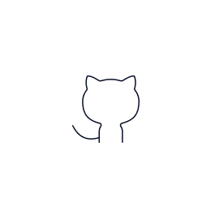

<div align="center">

  

  # گیتاب (Gitab)
  ### پلتفرم آزاد، متن‌باز و مدرن ترجمهٔ کتاب‌های مرجع مهندسی نرم‌افزار

  <p align="center">
    <strong>دسترسی آزاد، سریع و رایگان جامعه مهندسی و دانشجویان فارسی‌زبان به جدیدترین مراجع فنی جهان</strong>
  </p>

  <p align="center">
    <a href="https://hheydarian.github.io/Gitab/" target="_blank">
      
    </a>
  </p>

  <p align="center">
    <a href="https://github.com/hheydarian/Gitab/blob/main/LICENSE"></a>
    
    
    
  </p>

</div>

---

## 🎯 دربارهٔ پروژه گیتاب

**گیتاب (Gitab)** یک ابتکار مستقل و داوطلبانه برای شکستن سد زبانی در یادگیری عمیق مهندسی نرم‌افزار است. ما بر این باوریم که دسترسی به منابع دست اول، استاندارد و جامع نباید وابسته به هزینه‌های سنگین ارزی یا ترجمه‌های تجاری غیردقیق باشد.

در گیتاب، ترجمه‌های تخصصی به‌صورت **ملی، روان، ساختاریافته و با حفظ اصطلاحات کلیدی فنی** آماده شده و در قالب یک وب‌سایت مدرن و پرسرعت در اختیار همگان قرار می‌گیرد.

### 🌟 ویژگی‌های کلیدی پلتفرم
- 📖 **مطالعه آنلاین با تجربه کاربری مدرن:** طراحی مینیمال الهام‌گرفته از مستندات React.dev با تایپوگرافی استاندارد وزیرمتن.
- 📥 **دانلود رایگان PDF:** امکان دریافت نسخهٔ یکپارچه PDF فارسی هر کتاب تنها با یک کلیک.
- 💻 **بخش‌های کدخوان و خوانایی بهینه:** هایلایت رنگی کدهای برنامه‌نویسی و دکمهٔ سریع کپی.
- 🧭 **مسیرهای راهنمای سرفصل‌ها:** فهرست بازشونده (Accordion) فصول با محاسبه هوشمند گام و فصل بعدی.
- ⚡ **سرعت فوق‌العاده:** تولید ایستا (SSG) توسط Eleventy با لود آنی و بدون وابستگی به فریم‌ورک‌های سنگین.

---

## 📚 کتابخانه کتاب‌های گیتاب

هم‌اکنون ۸ اثر برجسته و معتبر بین‌المللی در اکوسیستم گیتاب دردسترس قرار دارد:

| ردیف | نام کتاب | نویسنده(ها) | حوزه تخصصی | مخزن سورس ترجمه |
|:---:|:---|:---|:---|:---:|
| ۱ | **C# 12 in a Nutshell** | Joseph Albahari | سی‌شارپ ۱۲ و دات‌نت ۸ | [مشاهده در گیت‌هاب](https://github.com/hheydarian/csharp-12-in-a-nutshell-persian) |
| ۲ | **Clean Code in C#** | Jason Alls | کد تمیز، اصول SOLID و ریفکتورینگ | [مشاهده در گیت‌هاب](https://github.com/hheydarian/clean-code-in-csharp-persian) |
| ۳ | **Clean Code** | Robert C. Martin (عمو باب) | چابکی، ساختار و مهندسی نرم‌افزار | [مشاهده در گیت‌هاب](https://github.com/mojtaba-afraz/clean-code-persian) |
| ۴ | **Task Programming in C# and .NET** | Rahul Rai & Perris Husney | همزمانی، Async/Await و Taskها | [مشاهده در گیت‌هاب](https://github.com/hheydarian/task-programming-in-csharp-dotnet-persian) |
| ۵ | **The Linux Command Line (TLCL)** | William E. Shotts | لینوکس، شل بش و اسکریپت‌نویسی | [مشاهده در گیت‌هاب](https://github.com/hemansadeghi/TLCL-Persian) |
| ۶ | **Apprenticeship Patterns** | Adewale Oshineye & Dave Hoover | الگوهای شاگردی و مسیر شغلی برنامه‌نویس | [مشاهده در گیت‌هاب](https://github.com/hheydarian/apprenticeship-patterns-persian) |
| ۷ | **The Pragmatic Programmer** | David Thomas & Andrew Hunt | بینش و تفکر مهندس نرم‌افزار حرفه‌ای | [مشاهده در گیت‌هاب](https://github.com/hheydarian/the-pragmatic-programmer-persian) |
| ۸ | **Understanding Domain-Driven Design** | مهدی کاظمی (گردآوری: حامد حیدریان) | معماری نرم‌افزار و طراحی دامنه‌محور | [مشاهده در گیت‌هاب](https://github.com/hheydarian/Understanding-Domain-Driven-Design) |

---

## 🤝 نحوهٔ مشارکت در گیتاب

گیتاب با انرژی و همیاری جامعه نرم‌افزاری به حیات خود ادامه می‌دهد. شما می‌توانید از راه‌های زیر به این جنبش علمی بپیوندید:

1. **ترجمه فصول جدید:** مشارکت در ترجمه فصل‌های باقیمانده یا آغاز ترجمهٔ یک اثر مرجع جدید.
2. **ویرایش و بازخوانی:** تصحیح غلط‌های املایی، بهبود معادل‌گزینی‌های فارسی و روان‌سازی جملات.
3. **بهبود رابط کاربری و سایت:** ارسال PR برای بهینه‌سازی تم‌ها، استایل‌ها و امکانات کتابخوان.
4. **گزارش باگ و پیشنهاد کتاب:** ایجاد [Issue](https://github.com/hheydarian/Gitab/issues) جدید برای معرفی کتاب‌هایی که جامعه نرم‌افزاری به آن‌ها نیاز دارد.

---

## 💻 راهنمای راه‌اندازی و توسعه محلی

پروژه به کمک ژنراتور سایت ایستای **Eleventy (11ty)** کامپایل می‌شود. برای اجرای پروژه بر روی سیستم خود:

```bash
# ۱. کلون کردن مخزن
git clone https://github.com/hheydarian/Gitab.git
cd Gitab

# ۲. نصب وابستگی‌ها
npm install

# ۳. اجرای سرور توسعه محلی
npm run dev
```

سپس مرورگر خود را باز کرده و به آدرس زیر بروید:
```text
http://localhost:8080/Gitab/
```

برای ساخت نسخهٔ نهایی جهت استقرار (Production Build):
```bash
npm run build
```

---

## 📄 لایسنس و حقوق نشر

محتوای ترجمه‌ها و کدهای این پلتفرم تحت پروانهٔ آزاد **[MIT License](LICENSE)** منتشر شده‌اند. استفاده، بازنشر و گسترش آن برای اهداف آموزشی با ذکر منبع کاملاً آزاد و رایگان است.

<div align="center">
  <p>طراحی و توسعه با ❤️ برای جامعه برنامه‌نویسان و مهندسان نرم‌افزار ایران</p>
  <p><strong>گیتاب ۲۰۲۶ — Gitab Platform</strong></p>
</div>
