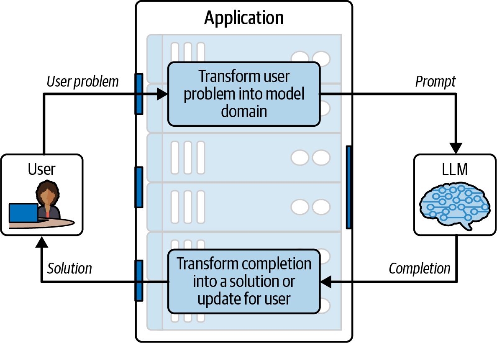


# فصل چهارم: طراحی برنامه‌های کاربردی مدل‌های زبانی بزرگ (Designing LLM Applications)

دو فصل گذشته پایه‌های لازم را برای بخش‌های باقی‌مانده کتاب بنا نهادند. در فصل به‌تفصیل نشان داده شد که۲ مدل‌های زبانی بزرگ (LLM) چگونه کار می‌کنند، و نشان دادیم که این مدل‌ها در غایت امر، عملاً مدل‌های تکمیل سند (document completion models) هستند که محتوا را توکن‌به‌توکن (یک توکن در هر گام) پیش‌بینی می‌کنند. فصل ۳ توضیح داد که چگونه رابط برنامه‌نویسی کاربردی گفتگو (chat API) بر پایه مدل‌های زبانی بزر فصل ساخته می‌شود. با۲ اندکی قند نحوی (syntactic sugar) در سطح API و میزان مناسبی از ریزتنظیم (fine-tuning)، از مدل تکمیل سند برای کامل کردن مکالمات میان کاربر و یک دستیار فرضی استفاده می‌شود. وقتی دقیقاً و موشکافانه بنگرید، مدل گفتگو در واقع هنوز هم یک مدل تکمیل سند است؛ با این تفاوت که اسنادی که تکمیل می‌کند، همگی رونوشت‌های گفتگو (conversation transcripts) هستند.

از این نقطه به بعد در کتاب، هر آنچه را که برای ساخت برنامه‌های کاربردی LLM جهت حل مسائل به نمایندگی از شرکت و کاربرانتان نیاز دارید، خواهید آموخت. این فصل به عنوان مدخلی برای ورود به این مباحث عمل می‌کند. در این فصل، به درون برنامه‌های کاربردی LLM عمیق خواهیم شد؛ برنامه‌هایی که خواهید دید در اصل یک لایه تبدیل (transformation layer) میان دامنه مسئله کاربر و دامنه متنی مدل هستند. علاوه بر این، برنامه کاربردی LLM یک لایه تبدی هدفمند است؛ با هدف حل مسئله!

کالبدشناسی حلقه ● در شکل ۴ -، برنامه کاربردی۱ LLM در قالب یک «حلقه» نمایش داده شده است، به این معنا که تعاملی رفت‌وبرگشتی میان کاربر و مدل برقرار است. دامنه‌های مدل و کاربر غالب کاملاً متمایز از یکدیگرند. کاربر ممکن است مشغول انجام کارهای متعددی باشد؛ مثًال نوشتن یک رایانامه (ایمیل) و جستجو برای یافتن کلمات دقیقاً جهت انتقال پیام خود. یا ممکن است در حال انجام کاری پیچیده باشد، نظیر سازماندهی یک سفر گروهی، رزرو بلیت‌های مسافرت و تهیه اقامتگاه. شاید هم کاربر مستقیماً با برنامه کاربردی LLM در تعامل نباشد؛ برای نمونه، ممکن است فرایند تحلیل تکرارشونده‌ای را تنظیم کرده باشد که برنامه کاربردی LLM با دردسترس قرار گرفتن داده‌های جدید، آن را به‌طور دوره‌ای اجرا کند. نکته حائز اهمیت این است که کاربر می‌تواند کارهای بسیار گوناگونی انجام دهد.

از سوی دیگر، مدل تنها یک کار انجام می‌دهد: اسناد را تکمیل می‌کند. اما همین قابلیت، انعطاف‌پذیری فوق‌العاده‌ای هنگام ساخت برنامه کاربردی LLM به شما می‌بخشد. توانایی تکمیل اسناد به مدل امکان می‌دهد ایمیل‌ها، کدها، داستان‌ها، مستندات و (اصولاً) هر چیزی را که یک انسان ممکن است بنویسد، به رشته تحریر درآورد. همان‌گونه که در فصل پیشین نشان دادیم، یک برنامه چت، نوعی برنامه کاربردی LLM است که اسناد رونوشت را تکمیل می‌کند؛ و اجرای ابزار (tool execution) صرف برداشتن یک گام فراتر و تکمیل یک سند رونوشت تخصصی است که شامل نح فراخوانی تابع (function calling syntax) است. با وجود توانایی مدل‌های زبانی بزرگ در تکمیل متن، مشارکت در گفتگو و اجرای ابزارها، می‌توان آن‌ها را در گستره‌ای تقریباً نامحدود از سناریوهای کاربردی به کار گرفت.

شکل ۴: - برنامه‌های کاربردی مبتنی بر۱ LLM حلقه‌ای را پیاده‌سازی می‌کنند که اطلاعات را از دامنه کاربر به دامنه متنی LLM و سپس مجدداً بازمی‌گرداند.

این حلقه، وظیفه پیاده‌سازی فرایند تبدیل میان دامنه کاربر و دامنه مدل را بر عهده دارد. حلقه مسئله کاربر را گرفته و آن را به سند یا رونوشتی تبدیل می‌کند که مدل باید آن را تکمیل کند. پس از آنکه مدل پاسخ داد، حلقه خروجی مدل را مجدداً به شکل راه‌حلی برای مسئله کاربر (یا دست‌کم گامی در جهت درست) به دامنه کاربر بازمی‌گرداند.

برنامه کاربردی LLM ممکن است تنها شامل یک دور گردش در این حلقه باشد. به عنوان مثال، اگر کاربر در حال نوشتن ایمیلی باشد و بخواهد فهرستی از نکات بالت‌پوینت‌شده را به نثری پیوسته تبدیل کند، تنها به یک بار تکرار در این حلقه نیاز خواهید داشت؛ به محض آنکه مدل نثر پیوسته را بازگرداند، وظیفه برنامه به اتمام رسیده است. کاربر در صورت تمایل می‌تواند برنامه را دوباره اجرا کند، اما در هر نوبت، حلقه هیچ وضعیتی (state) را از اجرای قبلی حفظ نمی‌کند.

در مقابل، برنامه کاربردی LLM ممکن است این حلقه را چندین بار پیاپی اجرا کند، همان‌طور که در مورد یک دستیار گفتگو محور صدق می‌کند. یا اینکه برنامه کاربردی ممکن است به‌طور مکرر اجرا شود، به حجم وسیعی از وضعیت‌ها رجوع کند و با تغییر شکل مسئله، حلقه را دستخوش تغییر نماید. یک برنامه برنامه‌ریزی سفر، مثالی عالی از این سناریو است. در ابتدا، برنامه در ایده‌پردازی برای گزینه‌های سفر همفکری می‌کند؛ سپس، به سراغ انجام ترتیبات واقعی سفر می‌رود؛ و در نهایت، یادآورها و نکات مربوط به سفر را تنظیم می‌نماید.

در بخش‌های پیش‌رو، شما را به یک چرخش کامل در حلقه شکل ۴ - خواهیم برد. ما به بحث پیرامون دامنه مسئله کاربر۱ خواهیم پرداخت، آن مسئله را به دامنه مدل تبدیل خواهیم کرد، متن تکمیل‌شده (completion) را گردآوری نموده و آن را دوباره به یک راه‌حل برای کاربر تبدیل خواهیم کرد.

مسئله کاربر ● این حلقه با کاربر و مسئله‌ای که درصدد حل آن است آغاز می‌شود. جدول ۴ - مشخص می‌سازد که چگونه دامنه مسئله۱ کاربر می‌تواند بر اساس چندین ُبعد متفاوت باشد و از سطوح ساده تا بسیار پیچیده تغییر کند. این ابعاد عبارتند از:

بستری که مسئله در آن منتقل می‌شود: (که متن، طبیعی‌ترین بستر برای مدل‌های زبانی بزرگ است) سطح انتزاع: (که انتزاع ب التر، نیازمند استدلال پیچیده‌تری است) اطلاعات زمینه‌ای (Context) مورد نیاز: (که اغلب دامنه‌ها علاوه بر اطلاعات ارائه‌شده توسط کاربر، مستلزم بازیابی اطلاعات تکمیلی نیز هستند) میزان وابستگی مسئله به وضعیت Stateful(بودن:() که دامنه‌های مسائل پیچیده‌تر، نیازمند حافظه‌ای از تعاملات گذشته و ترجیحات کاربر هستند) همان‌گونه که در جدول ۴ - مشاهده می‌کنید، دامنه‌های مسئله کاربر در ابعاد مختلف دارای سطوح گوناگونی از پیچیدگی۱ هستند. به عنوان مثال، یک برنامه نمونه‌خوانی و ویراستاری (proofreading) در تمام ابعاد دارای پیچیدگی پایینی خواهد بود، در حالی که یک دستیار برنامه‌ریزی سفر بسیار پیچیده خواهد بود. هنگام توسعه یک برنامه کاربردی LLM، شما با تمام این گونه‌های پیچیدگی به شیوه‌های مختلف دست‌وپنجه نرم خواهید کرد. ما در این فصل پیش‌درآمدی بر این رویکردها ارائه می‌دهیم و در فصول آتی کتاب، آن‌ها را با جزئیات کامل بررسی خواهیم کرد.

### ### جدول ۴ - ۱: ابعاد پیچیدگی مسائل کاربران در سه دامنه نمونه

| بعد پیچیدگی | غلط‌گیری و ویراستاری متن (Proofreading) | پشتیبانی فنی فناوری اطلاعات (IT Support) | برنامه‌ریزی جامع سفر (Travel Planning) |
| :--- | :--- | :--- | :--- |
| **بستر مسئله (Medium)** | متن ورودی کاربر | تماس صوتی / گفتگوی آنلاین با کاربر | تعاملات وب، فرم‌های ورودی، استعلام پرواز و هتل از APIها |
| **سطح انتزاع (Abstraction)** | عینی، کاملاً معین و با دامنه مشخص | فضای مسئله گسترده با پاسخ‌های متنوع، اما مقید به مستندات فنی | نیازمند درک عمیق سلایق ذهنی کاربر و تطبیق با محدودیت‌های بودجه و زمان |
| **وابستگی داده‌ای (Data Context)** | منحصر به متن ارائه‌شده | پایگاه دانش سازمانی، لاگ‌های سیستمی و راهنماها | قیمت‌های بلادرنگ پروازها، وضعیت آب‌وهوا، نقشه و موجودی هتل‌ها |
| **میزان قطعیت پاسخ** | خروجی معین (اصلاح املایی/نگارشی) | راه‌حل‌های قطعی و از پیش تعریف‌شده مهندسی | نیازمند بهینه‌سازی چندمعیاره و هماهنگی چندین سامانه خارجی |

