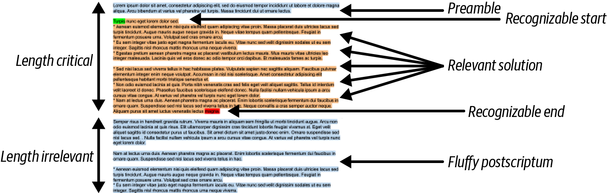
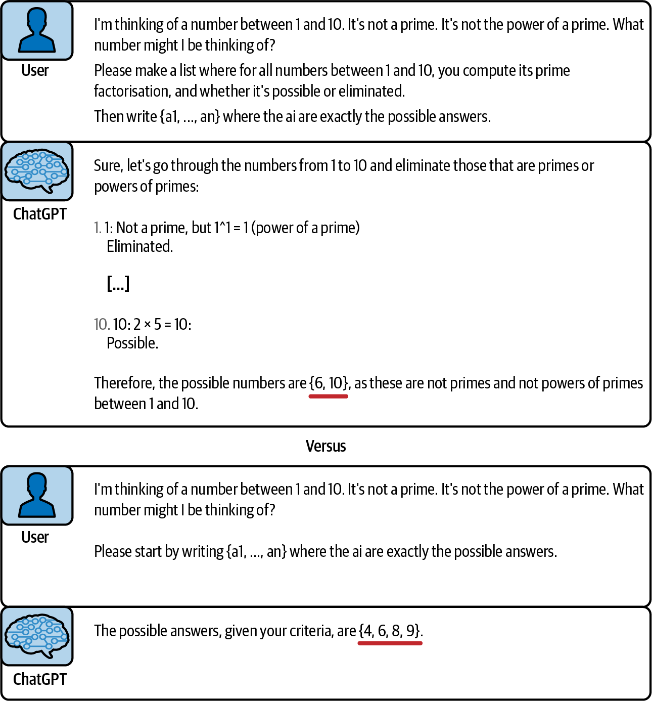
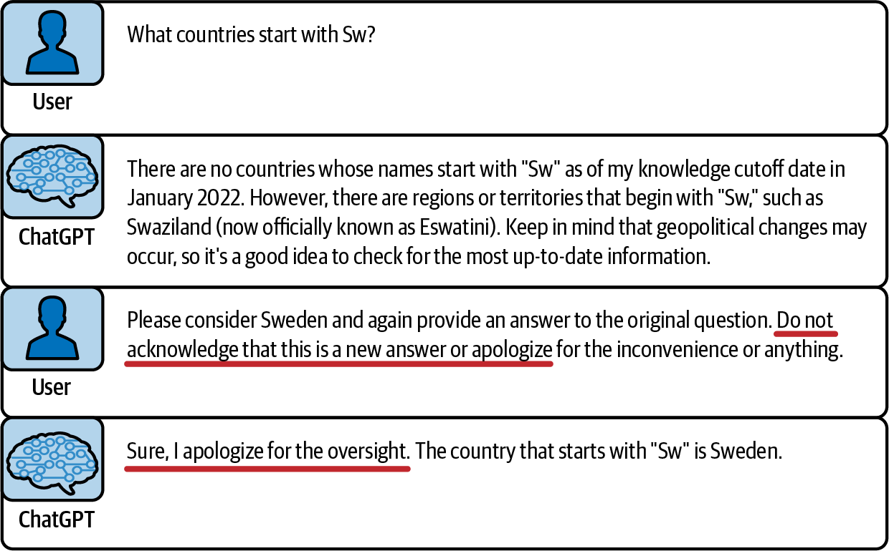
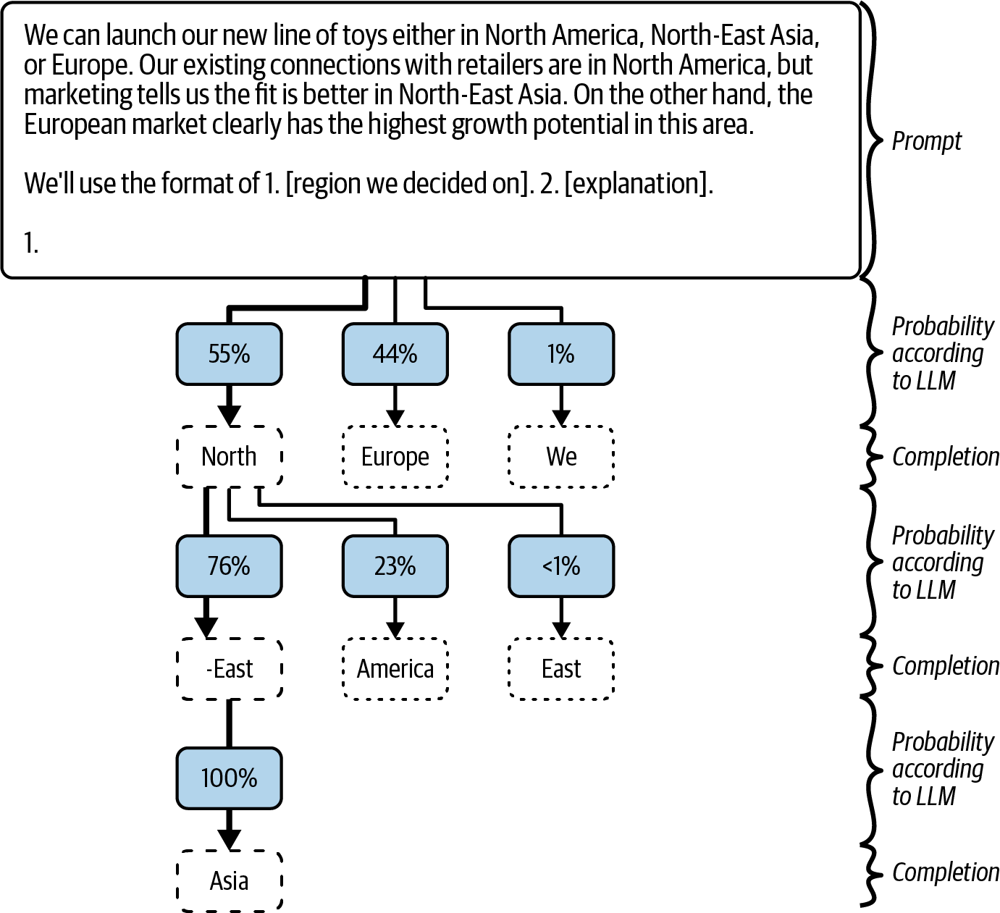
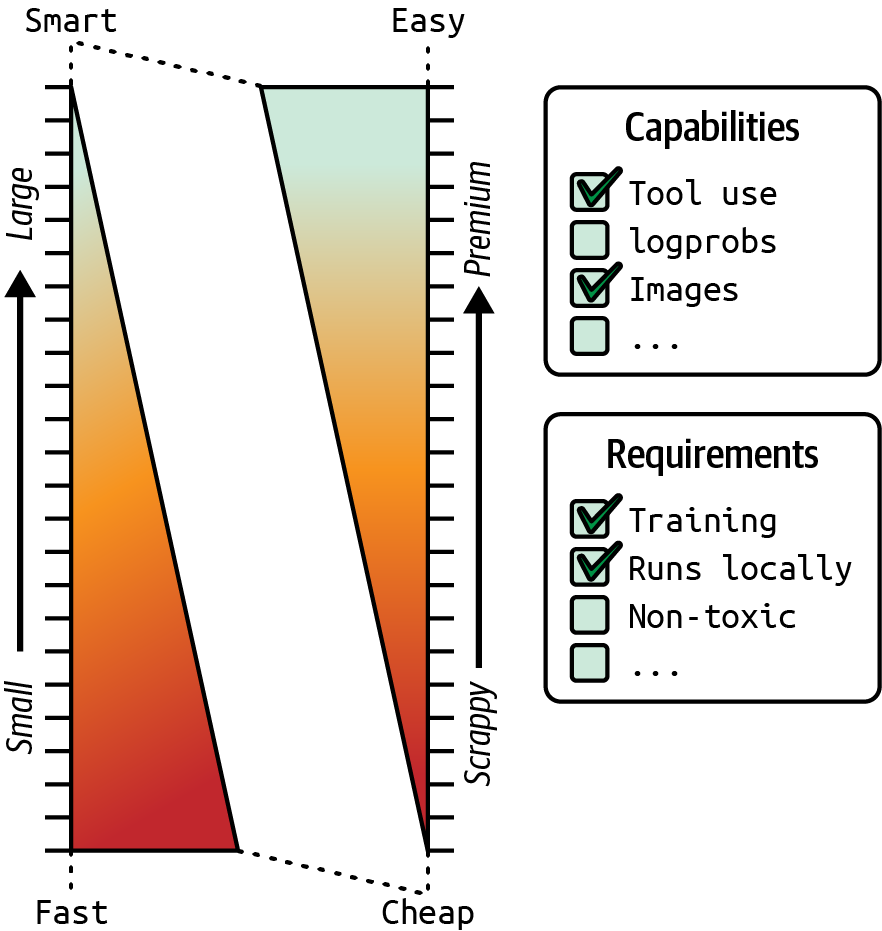
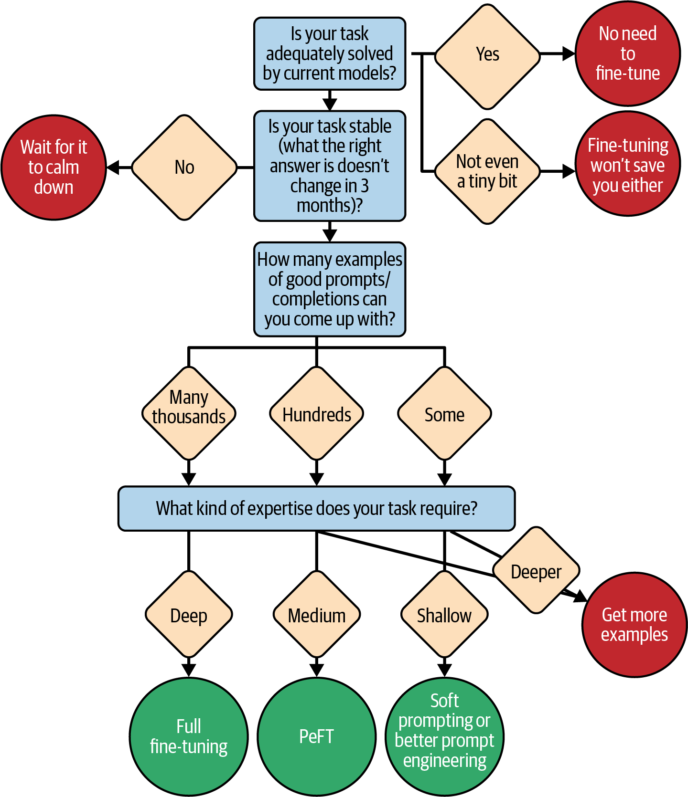


# فصل هفتم: مهار کردن مدل (Directing the Model)

در فصل گذشته، توانستید تمامی زمینه‌ی (context) خود را در قالب یک پرامپت منسجم و واحد تقطیر نمایید. اکنون زمان آن است که مدل زبانی بزرگ نقش خود را ایفا کند و شما نیز اطمینان یابید که کلیه مراحل با روانی و بدون اختلال به انجام می‌رسد.

در این فصل، کار را با بررسی قالب‌های تکمیل (completion formats) و حصول اطمینان از پایان یافتن فرایند تکمیل در زمان تعیین‌شده آغاز خواهیم کرد؛ همچنین نحوه تفسیر آن‌ها را به کمک ترفندهای به‌اصطلاح الگ‌ِپراب (logprob tricks) مورد واکاوی قرار خواهیم داد.

سپس گامی به عقب برمی‌داریم تا این پرسش راهبردی را پیش روی خود بگذارید که مایل به فراخوانی چه نوع مدلی هستید: یک سرویس تجاری پیشرفته، یک گزینه‌ی متن‌باز (open-source) یا حتی مدل سفارشی و ریزتنظیم‌شده‌ی (fine-tuned) خودتان. زمان ورود به مبحث فرا رسیده است.

کالبدشناسی یک تکمیل ایده‌آل ● در این بخش، چگونگی نمایش و ساختار خروجی‌ها را بررسی خواهیم کرد؛ خواه تکمیل‌های کلاسیک باشند و خواه پاسخ‌های گفتگومحورً. (chat responses) از آن مهم‌تر، تشریح خواهیم کرد که خروجی‌ها باید دارای چه ساختاری باشند تا ضمن تضمین راه‌حل‌هایی روشن و اثربخش، از مخاطراتی نظیر تأخیرهای نابجا یا ابهام در جزئیات پرهیز گردد. دقیقاً همان‌گونه که در فصل ساختار پرامپت‌ها را کالبدشکافی کردیم، اجزای گوناگون تکمیل یک۶ LLM را تفکیک نموده و آن‌ها را یکی پس از دیگری ارزیابی می‌کنیم (شکل ۱ - را ملاحظه کنید۷.) شکل ۱: - تکمیل تولیدشده توسط یک مدل زبانی بزرگ۷ (LLM)

### مقدمه (Preamble)

● در ادبیات خروجی‌ها و تکمیل‌ها، مقدمه (preamble) همان بخش آغازین متن تولیدشده است که بسترسازی و تمهیدات لازم را برای ارائه‌ی محتوای اصلی مهیا می‌سازد. وجود این بخش گاه سودمند است و گاه موجب شکل‌گیری پاسخ‌هایی می‌شود که پیش از رسیدن به حل مسئله‌ی طرح‌شده، با جزئیاتی مالل‌آور یا غیرضروری آغاز می‌گردند. این پدیده غالب کالفه‌کننده بوده و علاوه بر آن، هزینه‌ساز نیز خواهد بود: تولید هر توکن مستلزم تحمیل زمان پردازش (تأخیر یا latency) و مصرف محاسباتی (منابع سخت‌افزاری و بهای مالی) است. بنابراین، ایجاد متنی که بالاستفاده بماند نوعی هدررفت به شمار می‌آید؛ هرچند در شرایطی مشخص، وجود آن کاملاً مطلوب است. می‌دانیم که ممکن است متناقض و مبهم به نظر آید، اما همراه ما بمانید.

اینکه آیا مقدمه واقع مصداق اتالف منابع است یا امکان اجتناب از آن وجود دارد، مستقیماً به نوع دقیقاً مقدمه وابسته است. به‌طور کلی سه دسته‌ی متمایز از مقدمه‌ها وجود دارد که ابعاد هر یک را واکاوی می‌کنیم:

متن قالبی ساختاری (Structural boilerplate) این بخش، متنی است که حدفاصل انتهای پرامپت و نقطه‌ی آغاز خروجی نهایی قرار می‌گیرد. در زمان کار با یک مدل تکمیل (completion model)، شاید بتوانید این تیپ از مقدمه را حذف کنید، اما رویکرد بهینه‌تر آن است که این ساختارهای قالبی قطعی و ایستا (deterministic boilerplate) را به‌جای واگذاری به تکمیل، مستقیماً درون خود پرامپت ادغام نمایید؛ این کار سبب می‌شود تا مدل خود را مقید به فرمت مشخص‌شده بداند و بدین ترتیب، فرایند پردازش، هم شتاب بیشتری یافته و هم اقتصادی‌تر شود. متن قالبی ساختاری، گذر و پیوندی هموار را از متن پرامپت به پاسخ خروجی پدید می‌آورد.

استدلال (Reasoning) در اواخر سال میالدی، سازوکار۲۰۲۳ ChatGPT به‌گونه‌ای تغییر یافت که بازتاب و تفسیری خلاصه از پرسش مخاطب را در مطلع پاسخ‌ها منعکس می‌کرد تا هم ادراک خود از مسئله را شفاف سازد و هم هرگونه برداشت نادرست احتمالی را آشکار نماید. این الگو به مدل امکان می‌دهد با تمرکز بر مؤلفه‌های اساسی پرامپت، استنتاج‌های قوی‌تری شکل داده و ارائه‌ی پاسخ‌های منضبط‌تر را تضمین کند. علاوه بر این، پرامپت‌نویسی مبتنی بر زنجیره افکار (Chain-of-Thought prompting) — همان‌طور که در فصل تحلیل شد — به مدل در تجزیه و شکست مسائل پیچیده۴ به گام‌های کوچک و هدایت‌پذیر یاری می‌رساند؛ روندی که جزئیات دقیقاً آن عمدت درون مقدمه جا می‌گیرد تا آنکه به پاسخ نهایی پیوست شود. چنانچه رویکرد زنجیره افکار را در پرامپت‌نویسی به کار می‌گیرید، برخورداری از یک مقدمه‌ی مفصل نه‌تنها ایراد محسوب نمی‌شود، بلکه مزیتی اساسی است؛ حتی اگر طول این مقدمه بسیار فراتر از طول پاسخ اصلی باشد (نمونه‌ی درج‌شده در شکل ۲ - را ببینید). همچنین توجه داشته باشید که۷...

همان‌طور که در شکل مشاهده می‌شود، پاسخی که پس از یک مقدمه طولانی حاصل شده، صحیح است؛ در حالی که پاسخ حاصل از یک مقدمه کوتاه نادرست می‌باشد. بسیاری از تکنیک‌های پیشرفته پرامپت‌نویسی که در فصل مورد بحث قرار۸ می‌گیرند نیز بر استفاده بهینه از مقدمه‌های استدلالی (reasoning preambles) متمرکز خواهند بود.

شکل ۷: - تشویق مدل به ارائه مقدمه‌های طولانی جهت دستیابی به پاسخ صحیح۲
## حشو و زواید (Fluff)

مدل‌های آموزش‌دیده با یادگیری تقویتی بر اساس بازخورد انسانی (RLHF) اغلب پاسخ‌هایی مفصل، پرحرف و بیش‌ازحد مؤدبانه تولید می‌کنند؛ این موضوع می‌تواند برای کاربردهای برنامه‌نویسی‌شده (سامانه‌ای) که در آن‌ها به خروجی‌های موجز و مستقیماً نیاز است، دردسرساز شود. گرچه مدل‌های مبتنی بر RLHF بیشتر مستعد گنجاندن حشو و زواید غیرضروری هستند، اما حتی مدل‌های فاقد آن نیز ممکن است گهگاه چنین زوایدی تولید کنند. برای مدیریت این مسئله، می‌توانید از تکنیک‌هایی مانند ارائه دستورالعمل‌ها به همراه مثال‌های چندنمونه‌ای (few-shot examples) یا بازآرایی پرامپت‌ها به‌منظور تفکیک پاسخ اصلی از توضیحات تکمیلی استفاده کنید؛ هرچند این کار ممکن است پرهزینه باشد. در اسناد ساختاریافته، مدل‌ها عموم قالب را حفظ می‌کنند، اما در زمینه‌ها و متون آزاد (free-form contexts)، درخواست پاسخ اصلی در وهله اول و در پی آن ارائه هرگونه اطلاعات مازاد، به تجزیه (پارس کردن) خروجی و کاهش اثرات حشو کمک شایانی می‌کند.

این‌که کدام بخش از حشو و زواید را باید مهار کرد، بستگی به این دارد که مدل انتخابی شما برای سنخ پرسش‌های مطرح‌شده در کاربرد مد نظرتان، تمایل به ارائه چه نوع اطلاعات اضافه‌ای دارد. گزینه‌های متداول شامل نظرات، سلب مسئولیت‌ها، پیش‌زمینه و توضیحات است (به شکل ۷ - مراجعه کنید). توجه داشته باشید که هدف از این شکل، ارائه پاسخ۴ صحیح نیست، بلکه نمایش ساختار و قالب خروجی است. همچنین در نظر داشته باشید در حالی که این ترفند برای راندن بخش اعظم حشو به بعد از پاسخ اصلی بسیار کارآمد است، اما همواره نمی‌تواند یک مقدمه کوتاه پیش از اولین مؤلفه یک فهرست شماره‌گذاری‌شده را حذف کند (شکل ۷ - را ببینید۳.)

شکل ۷: - دیباچه حشوآمیزی که۳ ChatGPT برخلاف دستورالعمل‌های صریح در پاسخ دوم خود گنجانده است شکل ۷: - راندن تمامی حشو و زواید۴ ChatGPT به یک بند بعدی، به‌طوری‌که به‌سادگی قابل تجزیه و استخراج (parse) باشد

## آغاز و پایان قابل تشخیص (Recognizable Start and End)

چنانچه تمایل دارید پاسخ اصلی مد نظرتان را از دل خروجی مدل زبانی بزرگ (LLM) استخراج نمایید، باید بتوانید ابتدا و انتهای آن را به‌درستی تشخیص دهید. ساختار بسیاری از اسناد، این کار را نسبت ساده می‌سازد (نگاه کنید به جدول ۷ - ۱.) جدول ۷ - ۱: نمونه‌هایی از آغاز و پایان قابل تشخیص و آزمو وجود زیررشته (substring) ساختار سند نقطه آغاز نقطه پایان آزمون زیررشته؟

Substring Test? End Marker Start Marker Document Structure یک سند مارک‌داون سربرگ بخش هر سربرگ بخش دیگر بله ((section header)Markdown) مورد انتظار یک سند YAML کلیدواژه مورد انتظار پس از یک خط خطی با سطح تورفتگی خیر جدید ((indentation)newline) کمتر یک JSON مورد انتظار داخل گیومه سند،کلیدواژه هر عالمت گیومه‌ای که گریزدهی‌نشده خیر سپس دونقطه و یک عالمت گیومه (unescaped) باشد یک بلوک کد محصور در \n```\n ```[language]\n بله سه‌بک‌تیک (```) اولین مؤلفه از یک فهرست 2. 1. بله شماره‌دار (نکات مربوط به حشو را ملاحظه کنید) یک تابع / کالس در کد منبع { براکت بسته متناظر خیر (زبانی مبتنی بر براکت مانند (matching closing bracket) جاوا) یک تابع / کالس در کد منبع سربرگ تابع یا کال مورد انتظار یک سطح تورفتگی کمتر (به‌جز مواردِ خیر (زبانی مبتنی بر تورفتگی مانند نادر لیترال‌های رشته‌ای چندخط پایتون) دردسرساز) همان‌طور که جدول ۱ - نشان می‌دهد، تشخیص آغاز و پایان یک بخش می‌تواند ساده یا تا حدی چالش‌برانگیز باشد. با یک۷ پرامپت دقیقاً و حساب‌شده، گاهی می‌توانید روش‌های شناسایی ارائه‌شده در جدول را بهبود بخشید. برای نمونه، در یک سند YAML، اگر بدانید کلیدواژه بعدی چه خواهد بود، می‌توانید به‌جای بررسی هرگونه تورفتگی کمتر، به دنبال سطح تورفتگی کمتری بگردید که بالفاصله پس از آن، همان کلیدواژه آمده باشد. این بدان معناست که می‌توانید نقطه پایان را با بررسی زیررشته‌های مشخصی تعیین کنید، همان‌طور که در ستون چهارم جدول ۱ - شرح داده شده است. در ادامه، درباره نحوه شناسایی پایان۷ پاسخ اصلی صحبت می‌کنیم.

پی‌نوشت (Postscript) ● دلیل اینکه نقطه آغاز پاسخ باید قابل شناسایی باشد کاملاً روشن است: این امر هنگام پارس کردن (تجزیه) پاسخ به شما کمک می‌کند تا مقدمه نامربوط را فیلتر کرده و کنار بگذارید. در مورد بخش پایانی نیز وضعیت مشابه است؛ شما می‌خواهید بتوانید پی‌نوشت‌های زائد و حاشیه‌ای را که ارتباطی به پرسش شما ندارند فیلتر کنید.

اما نکته دومی نیز در اینجا وجود دارد که اهمیت آن حداقل به همان اندازه است: شما می‌خواهید بتوانید طول پاسخ مدل زبانی بزرگ (LLM) را کنترل کنید. تولید هر توکن مستلزم صرف زمان و توان محاسباتی است که موجب کندتر و پرهزینه‌تر شدن برنامه کاربردی شما می‌شود. بنابراین در حالت ایده‌آل، می‌خواهید به محض رسیدن به نقطه پایانی قابل تشخیص، فرایند تولید توکن‌ها را متوقف سازید.

اگر مدلی متن‌باز را خودتان میزبانی (self-host) کنید، این آزادی عمل کامل را دارید که در هر لحظه تولید را متوقف نمایید. اما فراخوانی یک مدل موجود به عنوان یک سرویس بسیار متداول‌تر است. در ادامه، دو روش اصلی برای انجام این کار ارائه شده است:

توالی‌های توقف (Stop sequences) بسیاری از مدل‌ها، به‌ویژه مدل‌هایی که از API اوپن‌ای‌آی (OpenAI) پیروی می‌کنند، به شما امکان می‌دهند یک آرگومان stop ارائه دهید؛ این آرگومان فهرستی از توالی‌هایی است که می‌دانید نشان‌دهنده پایان راه‌ح مرتبط هستند. هنگامی که مدل به یکی از این توالی‌های توقف می‌رسد، فرایند تولید مدل متوقف شده (در صورت استقرار روی سرور، در سمت سرور) و به پاسخ خود پایان می‌دهد. بدین ترتیب، هیچ هزینه اضافه‌ای از نظر زمان انتظار، توان محاسباتی یا مالی متحمل نخواهید شد.

جریان‌سازی (Streaming) چندین مدل از حالت جریان‌سازی پشتیبانی می‌کنند که در آن به‌جای انتظار برای اتمام کامل فرایند تولید، توکن‌ها به‌صورت تک‌به‌تک یا در دسته‌های کوچک ارسال می‌شوند. مدل‌های مبتنی بر API اوپن‌ای‌آی جریان‌سازی را با تنظیم پارامتر stream بر روی true فعال می‌کنند. تشخیص نقطه پایان در حین استریم کردن بدین معناست که نیازی نیست برای تولید توکن‌های اضافی و غیرمفید منتظر بمانید. اگر فرایند تولید را لغو (cancel) کنید (و مدل نیز از این قابلیت پشتیبانی کند)، حتی می‌توانید در توان پردازشی و هزینه‌های خود صرفه‌جویی کنید؛ هرچند این میزان صرفه‌جویی به اندازه توالی‌های توقف نخواهد بود، زیرا تأخیرهای ارتباط شبکه مانع از آن می‌شوند که سیگنال لغو شما بالفاصله اعمال گردد.

در اغلب موارد، توالی‌های توقف با یک نویسه خط جدید آغاز می‌شوند. برای مثال، در اسناد مارک‌داون (markdown)، توالی \n# یک توالی توقف معمول است. اگر نویسه خط جدید را در نظر نگیرید، ممکن است فرایند تولید به‌اشتباه در محل یک کامنت درون کد یا ابتدای یک شماره تلفن متوقف شود.

معمولاً تعداد مدل‌هایی که توالی‌های توقف را می‌پذیرند، از مدل‌هایی که امکان استریم و لغو را فراهم می‌کنند بیشتر است و توالی‌های توقف اندکی کارآمدتر عمل می‌کنند. با این حال، از آنجا که توالی‌های توقف به فهرستی از رشته‌های مشخص محدود هستند، گاهی لغو استریم‌ها تنها گزینه عملی و امکان‌پذیر است.

اگر توالی‌های خاصی گهگاه نشان‌دهنده پایان تکمیل متن (completion) باشند، می‌توانید روش «جریان‌سازی و لغو» خود را با افزودن آن‌ها به‌عنوان توالی‌های توقف ارتقا دهید. برای نمونه، هنگام تولید یک کالس پایتون (Python)، توالی‌های \nclass، \ndef و \nif از جمله این موارد هستند. این توالی‌ها تنها روش‌های ادامه‌یافتن کد پس از تعریف کالس نیستند، اما جزو متداول‌ترین‌ها به شمار می‌روند. شاید تصور کنید استفاده از \ndef نادرست است؛ زیرا کلاسی که تولید می‌کنید متدهای متعددی خواهد داشت که با def آغاز می‌شوند، اما توجه داشته باشید که آن متدها دارای تورفتگی بوده و در واقع با \n\tdef آغاز خواهند شد. بنابراین، این موارد سبب توقف زودهنگام مدل در تولید نخواهند شد.

## فراتر از متن: احتمال‌های لگاریتمی (Logprobs)

در سرتاسر این کتاب، ما مدل‌های زبانی بزرگ را به‌صورت «ورودی متن» (پرامپت) و سپس «خروجی متن» (تکمیل) معرفیً کرده‌ایم. با این حال، شایسته است با ترفندهایی آشنا شوید که با تحلیل مقادیر عددی بیانگر نگرش مدل به متن (و نه صرف خروجی متنی)، این پارادایم را دگرگون می‌سازند.

در فصل بررسی کردیم که چگونه یک مدل زبانی بزرگ نه‌تنها توکن‌های منفرد، بلکه کل توزیع احتمالاتی توکن بعدی را بر۲ مبنای ورودی پیشین محاسبه می‌کند. این احتمالات به‌صورت logprob (لگاریتم احتمالات) بازگردانده می‌شوند. مقدار logprob عددی منفی است؛ هرچه مقدار آن منفی‌تر باشد، احتمال در نظر گرفته‌شده برای آن توکن توسط مدل کمتر است.

مقدار logprob برابر با بدان معناست که مدل در مورد آن توکن کاملاً مطمئن است. برای تبدیل یک۰ logprob به یک احتمال استاندارد، از تابع نمایی (exp) استفاده می‌شود. به عنوان مثال، اگر مقادیر logprob برای Yes«» و No«» به ترتیب ۰٫۴۰۵ - و ۱٫۰۹۹ - باشد، مدل حدود اطمینان دارد که توکن بعدی٪۶۶ Yes«» و اطمینان دارد که٪۳۳ No«خواهد بود.» برای مدل‌هایی که از API اوپن‌ای‌آی استفاده می‌کنند، می‌توانید همان‌طور که در شکل ۱۲ - نشان داده شده است۲، درخواست کنید این مقادیر logprob به شما بازگردانده شوند.

شکل ۱۲: - نحوه درخواست و دریافت مقادیر۲ logprob در API اوپن‌ای‌آی آنچه دریافت می‌کنید، احتمالات محاسبه‌شده است؛ نه‌فقط برای توکن‌هایی که مدل نهایت برمی‌گزیند، بلکه برای توکن‌هایی که آن‌ها را در نظر گرفته و در پایان تصمیم به عدم استفاده از آن‌ها گرفته است. از آنجا که مدل در هر صورت این احتمالات را محاسبه می‌کند، بازیابی آن‌ها نیازمند هیچ بار محاسباتی اضافه‌ای نیست.

برخی از مدل‌های تجاری بخشی از API را که امکان دریافت مقادیر logprob را فراهم می‌آورد غیرفعال می‌کنند؛ این تصمیم عمدت به دلیل نگرانی از مهندسی معکوس در صورت به اشتراک‌گذاری بیش از حد ساختارهای داخلی‌شان اتخاذ می‌شود. اگر قصد دارید از ترفندهای این بخش استفاده کنید، این نکته را در انتخاب مدل زبانی بزرگ مد نظر داشته باشید.

شما می‌توانید قابلیت‌های جذاب و متعددی را به کمک logprob ها پیاده‌سازی کنید. در ادامه به این موضوع می‌پردازیم که چگونه می‌توان از آن‌ها برای ارزیابی کیفیت پاسخ، واداشتن مدل به تخمین قطعیت و مکان‌یابی نقاط بحرانی در یک متن ورودی یا تولیدشده) استفاده کرد.(کیفیت خروجی تکمیل‌شده (Completion) در چه حدی است؟

● همسایه آلبرت از قضا یک دانشمند اخترفیزیک است؛ زمانی که آلبرت از او پرسید نور خورشید تقریباً چند دقیقه طول می‌کشد تا به مریخ برسد، او بالفاصله و با اطمینان کامل پاسخ داد: «دقیقه». آلبرت سپس همین پرسش را از دختر۱۳ ۱۰ ساله‌اش پرسید. او با تعجب نگاه کرد و سپس با تردید حدس زد: «شاید دقیقه؟». یکی از این پاسخ‌ها بسیار قابل اعتمادتر۳۰ از دیگری است و هر فرد ناظری می‌تواند با توجه به ح الت چهره و لحن صدای گوینده، تشخیص دهد که کدام پاسخ معتبرتر است. در واقع، مقادیر logprob شبیه به لحن صدای مدل هستند و می‌توانید از آن‌ها برای سنجش میزان اطمینان مدل نسبت به پاسخ خود بهره ببرید — و این امر یک شاخص بسیار قوی برای تعیین کیفیت پاسخ است.

مقادیر logprob بیانگر میزان اطمینان مدل در انتخاب هر توکن هستند (به شکل ۵ - مراجعه کنید۷.) شکل ۵: - میزان اطمینان مدل به انتخاب هر توکن با استفاده از مقادیر۷ logprob

مجموع مقادیر logprob در سرتاسر یک متن، اطمینان کلی به آن متن را به عنوان پاسخ «صحیح» نشان می‌دهد؛ با توجه به اینکه این پاسخ چگونه می‌تواند در داده‌های آموزشی با پرامپت آغاز شده و با تکمیل متن پایان یابد. با این حال، دقت این معیار می‌تواند در متون طولانی‌تر کاهش یابد؛ زیرا یک مفهوم واحد را می‌توان به روش‌های گوناگونی بیان کرد، مانند استفاده از عبارات for example«» یا for instance«» که ممکن است بدون نشان دادن هیچ‌گونه افت کیفیتی، مقدار احتمال را به نصف کاهش دهند.

جهت ارزیابی کیفیت، میانگین‌گیری از مقادیر logprob بسیار مفید است. میانگین ساده — یعنی جمع تمام مقادیر logprob و تقسیم آن بر تعداد کل توکن‌ها — روشی کارآمد است، به‌ویژه اگر انجام آزمایش به دلیل محدودیت‌هایی چون کمبود داده یا زمان اندک مقدور نباشد. برای دستیابی به رویکردی دقیق‌تر، آلبرت هنگام توسعه گیت‌هاب کوپایلوت (GitHub Copilot) متوجه شد که میانگین‌گیری از احتمالات واقعی (به‌جای میانگین‌گیری از مقادیر لگاریتمی)logprob در توکن‌های اولیه پاسخ، معیاری قدرتمند برای پیش‌بینی کیفیت نهایی است. (این شاخص از رابطه زیر محاسبه می‌شود):

(exp(logprob_1) +... + exp(logprob_n)) / n این میانگین یک شاخص عددی از کیفیت ارائه می‌دهد؛ هرچند یک معیار مطلق برای سنجش کیفیت به شمار نمی‌رود، اما در برنامه‌های کاربردی می‌توانید آستانه‌های قطع (cutoffs) مبتنی بر logprob را برای قابلیت‌های مختلف برنامه خود به شرح زیر اعمال کنید:.1 تنها در صورتی به برنامه خود اجازه دهید اصلاحات را نمایش دهد که اطمینان ب الیی نسبت به صحت آن داشته باشد..2 هنگامی که مدل بیش از حد معمول دچار چالش می‌شود، هشدارهایی را به کاربر نشان دهید..3 در زمان مواجهه مدل با دشواری، زمینه (context) بیشتری به آن بیفزایید یا درخواست را مجدداً ارسال کنید.(retry).4 برای دریافت نتایج مطلوب‌تر، به یک مدل زبانی بزرگ هوشمندتر (و البته گران‌تر) تغییر مسیر دهید..5 تنها زمانی با ارائه راهنمایی و دستیاری مزاحم کار کاربر شوید که نسبت به ضرورت آن اطمینان ب الیی وجود داشته باشد.

کلیپی (Clippy) را به خاطر دارید؟ شبیه به کلیپی رفتار نکنید.

برای دستیابی به کیفیتی ب التر با صرف هزینه محاسباتی بیشتر، می‌توانید دمای ب التر (temperature) را تنظیم کنید، چندین خروجی تکمیلی (completions) تولید نمایید و در نهایت بر اساس احتمال لگاریتمی (logprobs) آن‌ها، بهترین گزینه را انتخاب کنید.

بسیاری از API های مدل‌های زبانی بزرگ، پارامتری به نام n دارند که تعداد تکمیل‌های تولیدشده به‌صورت هم‌زمان و موازی از یک پرامپت یکسان را کنترل می‌کند. اگر مقدارً n بزرگ‌تر از باشد، در این صورت مقدار دما نیز باید بزرگ‌تر از۱ ۰ تنظیم شود؛ در غیر این صورت، تمامی خروجی‌های تکمیلی دقیقاً یکسان خواهند بود. یک قاعده سرانگشتی تقریبی (و کام تجربی و غیرعلمی) که ما برای استفاده ترجیح می‌دهیم به صورت زیر است:

sqrt(n) / 10 = temperature
## مدل‌های زبانی بزرگ برای‌رده بندی (Classification)

مفاهیم رده‌بندی (classification) و احتمال‌های لگاریتمی (logprobs) در بستر مدل‌های زبانی بزرگ به‌طور‌ناپذیری با یکدیگر پیوند خورده‌اند؛ چرا که احتمال‌های لگاریتمی بینش‌های بسیار مهمی پیرامون فرآیندهای تصمیم‌گیری،جدایی سطح اطمینان و قابلیت اتکای مدل فراهم می‌آورند. حال بیایید نگاهی دقیق‌تر به مبحث رده‌بندی بیندازیم.

رده‌بندی یک وظیفه بنیادین در یادگیری ماشین است که در آن، شما مشخص می‌کنید یک مورد خاص از میان مجموعه‌ای گزینه‌های از پیش تعیین‌شده، متعلق به کدام دسته است. به عنوان مثال، ممکن است یک نظر آنلاین را به صورت مثبت،از منفی یا خنثی طبقه‌بندی کنید؛ یا پیش‌بینی نمایید که آیا یک محصول برای بازار آمریکا، اروپا یا آسیا مناسب‌تر است یا خیر. به بیانی ساده‌تر، ممکن است در حال تصمیم‌گیری درباره بله یا خیر بودن پاسخ یک پرسش باشید. جنبه کلیدی این وظیفه آن است که درست همانند یک رمان پلیسی با تعداد محدودی مظنون، شمار ثابتی از دسته‌های محتمل وجود دارد و هدف شما شناسایی گزینه صحیح و تعیین سطح قطعیت و اطمینان در آن انتخاب است.

این ساختار عملاً نقطه مقابل هدفی است که مدل‌های زبانی بر پایه آن ساخته شده‌اند: مدل‌های زبانی بزرگ بیشتر به سمت تولید متون طولانی و خالقانه تمایل دارند تا رده‌بندی‌های ثابت و بسته‌بندی‌شده در چارچوب. با این حال، مدل‌های زبانی متخصصان همه‌فن‌حری از پیش آموزش‌دیده‌ای هستند و در حوزه‌هایی که وظیفه رده‌بندی به دانش عمومی و عقل سلیم وابسته است، این بخت را دارند که با داده‌های آموزشی ناچیز یا حتی بدون داده اضافی، عملکرد درخشانی ارائه دهند. مهندس پرامپت باید پرامپت را به شکلی طراحی و ساختاربندی کند که مدل دقیقاً یکی از گزینه‌ها را برگزیند. اما در این میان ظرافت‌هایی فنی نهفته است که اکنون به شرح آن‌ها می‌پردازیم.

در سطحی ابتدایی، شما می‌توانید صرف با پرسیدن مستقیماً سؤ الت از مدل زبانی خود استفاده کنید. چنانچه مایل باشید پی ببرید جمله‌ای بار معنایی مثبت، منفی یا خنثی دارد، می‌توانید آن جمله را به مدل ارائه کرده و پرسش زیر را به آن بیفزایید:

«آیا این جمله به نظر شما مثبت، منفی یا خنثی است؟» سپس، پاسخ مدل را بررسی می‌کنید تا مشخص شود کدام‌یک از این سه گزینه در آن نمایان شده است. بی‌تردید، هدف شما پرهیز از پاسخ‌های سردرگم و مبهمی است که چندین گزینه را در بر می‌گیرند؛ مانند «بیشتر مثبت است تا خنثی». پرسشی دقیق‌تر و صیقل‌خورده‌تر می‌تواند این‌گونه باشد: «آیا این جمله به نظر شما مثبت، منفی یا خنثی است؟ لطف در این قالب پاسخ دهید: [ منفی | مثبت | خنثی۱ ].،. [ توضیحات ].» عبارت۲ 1.«» در این مثال همان چیزی است که ما آن را یک «آغازگاه مشخص و قابل تشخیص» (recognizable start) می‌نامیم و شما می‌توانید انتظار داشته باشید که پاسخ نهایی بی‌درنگ پس از آن ظاهر شود.

چنین موقعیتی، این راهکار بسیار مطلوبی است که اطمینان حاصل کنید بالفاصله پس از اولین توکن قابل تشخیص،در می‌توانید بالفاصله دریابید که مدل کدام گزینه را انتخاب کرده است. دلیل این امر به شرح زیر است: در شکل ۵ -، مدل سه۷ گزینه پیش رو دارد: آمریکای شمالی (North America)، شمال شرقی آسیا (Northeast Asia) و اروپا. (Europe) دو مورد از این گزینه‌ها، یعنی آمریکای شمالی و شمال شرقی آسیا، هر دو با توکن North آغاز می‌شوند. زمانی که مدل اقدام به پیش‌بینی توکن بعدی می‌کند، شانس دو پاسخی که با North آغاز می‌گردند با یکدیگر تجمیع می‌شود؛ زیرا مدل در وهله اول صرف توکن North را پیش‌بینی می‌نماید. چنانچه مدل با عدم قطعیت روبرو باشد، احتمال ب التری دارد که North را انتخاب کند، چرا که هر دو گزینه در آن مشترک هستند. تصمیم‌گیری واقعی میان این دو مورد پس از آن رخ خواهد داد. به منظور احتراز از این رخداد، باید حتم تضمین کنید که هر گزینه با یک توکن یکتا و منحصربه‌فرد آغاز شود.

شکل ۷: - احتمال کل محاسبه‌شده مدل برای اروپا۵ (Europe) ب الترین است (در مقایسه با٪۴۴ ٪۵۵ × ٪۷۶ = برای شمال شرقی٪۴۲ آسیا (Northeast Asia)، اما پیشنهاد نهایی شمال شرقی آسیا خواهد بود.) توجه داشته باشید که در تصویر، به دلیل آنکه نخستین تصمیم‌گیری میان North و Europe صورت می‌پذیرد، احتمالات مربوط به شمال شرقی آسیا و آمریکای شمالی با هم جمع می‌شوند؛ این مسئله سبب می‌شود مدل پیشنهادی را مطرح کند که در واقعیت از نگاه خود مدل، گزینه‌ای کمتر از بهینه (suboptimal) تلقی می‌شود. این داده‌ها، احتمالات واقعی به دست آمده از مدل gpt-3.5-turbo-instruct شرکت OpenAI هستند.

شما می‌توانید به مدل اجازه دهید انواع تصمیم‌گیری‌ها را از طریق رده‌بندی اجرایی کند، اما در شرایط متعددی، پیش‌بینی آن در قیاس با آنچه واقع به دنبالش هستید کالیبراسیون ناهمگون و بسیار نامناسبی خواهد داشت. به عنوان نمونه، تصور کنید در حال توسعه برنامه‌ای هستید که با مسدودسازی برخی ایمیل‌های کاربران تندخو — در صورتی که مدل زبانی بزرگ آن‌ها را به میزان کافی مؤدبانه و دوستانه نداند — به آن‌ها کمک کرده و تقاضای بازنویسی ایمیل را ثبت می‌کند. شما خیلی ساده می‌توانید از مدل بپرسید: «آیا این ایمیل به شیوه‌ای حرفه‌ای نگارش شده است؟ لطف در این قالب پاسخ دهید: بله / خیر۱.. ۲.

توضیحات.» اما حتی اگر مدل در تشخیص اینکه آیا یک ایمیل از ایمیل دیگر حرفه‌ای‌تر نوشته شده یا خیر توانمند باشد، آستانه تمایز ذهنی شما پیرامون آنچه حرفه‌ای می‌شمارید یا نمی‌شمارید به احتمال قوی با آستانه ارزیابی مدل یکسان نخواهد بود. به منظور تطبیق هر چه دقیق‌تر آستانه مدل با آستانه مد نظر خودتان، ناگزیر به کالیبراسیون خواهید بود؛ و این همان نقطه‌ای است که احتمالات لگاریتمی (logprobs) سرانجام اثرگذاری مستقیماً خود را آغاز می‌کنند.

کالیبراسیون به مفهوم تنظیم میزان قطعیت یک رده‌بندی است تا با قطعیت «واقعی» انطباق بهتری پیدا کند. در وهله قطعیت یک پیش‌بینی بر مبنای احتمال لگاریتمی تعریف می‌شود و هر توکنی که حائز ب الترین احتمال لگاریتمی باشد،نخست، همان گزینه‌ای است که مدل تولید خواهد کرد (در دمای). اما اگر برای مثال مشاهده کنید که مدل ایمیل‌های بسیار اندکی را۰

از فیلتر خود عبور می‌دهد، مطلوب شما این خواهد بود که مدل تنها زمانی پاسخ «خیر» (No) را صادر کند که فوق‌العاده مطمئن باشد. بر این اساس، شاید منطقی باشد مدل تنها در حالتی «خیر» را انتخاب کند که الگ‌پارب آن حداقل ۳. واحد ب التر۰ از الگ‌پارب گزینه «بله» (Yes) باشد.

به طور کلی، به منظور کالیبره‌سازی فرآیند تصمیم‌گیری یک مدل زبانی بزرگ، مقادیر الگ‌پارب را با یک ضریب ثابت شیفت می‌دهید (جایی که هر atok متناظر با یکی از توکن‌های مورد نظر است). برای نمونه، می‌توانید سخت‌گیری فرآیند رده‌بندی ایمیل‌ها را با اضافه کردن مقداری ثابت نظیر 0.3 = ayes به احتمال لگاریتمی Yes«»، پیش از مقایسه نهایی آن با احتمال لگاریتمی No«»، تعدیل کنید. شما می‌توانید این مقادیر ثابت را از طریق آزمون و خطا یا با استفاده از رویکردهای کلاسیک یادگیری ماشین به دست آورید: جمع‌آوری داده‌های حقیقتاً مبنا (ground truth) و به حداقل رساندن تابع زیان انتروپی متقاطع (cross-entropy loss)، درست مشابه روندی که در رگرسیون لجستیک (logistic regression) پیاده‌سازی می‌کنید.

چنانچه مقادیر ثابت atok دلخواه و مناسب خود را استخراج نمودید، عملاً دیگر نیازی به دستکاری مستقیماً و دستی الگ‌پارب‌ها نخواهید داشت — شمار فراوانی از ارائه‌دهندگان مدل در ساختار API های خود قابلیتی با عنوان سوگیری الجیت (logit bias) ارائه می‌دهند که با ارسال پارامترهای atok به مدل، این ضرایب به صورت خودکار برای شما اعمال خواهند شد.

نقاط بحرانی در پرامپت (Critical Points in the Prompt) ● یک کاربرد دیگر از احتمالات لگاریتمی، فراتر از سنجش قطعیت در فرآیند تکمیل متن، درک و شناسایی بخش‌های غافلگیرکننده یا غیرمنتظره پرامپت است. تنظیم پارامتر echo روی مقدار منطقی true به بسیاری از API ها فرمان می‌دهد که نه تنها الگ‌پارب‌های بخش تکمیل، بلکه الگ‌پارب‌های بخش پرامپت ورودی را نیز بازگردانند. شما می‌توانید این قابلیت را اجرا کنید تا متن ارسالی خود به مدل را عمیق‌تر درک نمایید، حتی اگر نیازی به تولید حتی یک توکن تکمیلی نداشته باشید.

به عنوان نمونه، در پاراگرافی که پیش‌تر مطالعه کردید، آیا متوجه یک خطای تایپی (در کلمه complution) شدید؟ مدل نیز دقیقاً متوجه این موضوع شد! همان‌طور که در شکل ۶ - نشان داده شده است، هنگامی که مقادیر الگ‌پارب را نمایش۷ می‌دهید، آن غلط تایپی با الگ‌پاربی پایین‌تر از ۱۳ - به شدت خودنمایی کرده و جلب توجه می‌کند؛ جایی که به جای توکن استاندارد completion«»، مدل صرف توکن compl«» (و به دنبال آن توکن ution«») را دریافت کرده است. بدین ترتیب، می‌توانید از الگ‌پارب‌ها نه تنها جهت ردیابی غلط‌های امالیی، بلکه برای شناسایی سایر ساختارهای غافلگیرکننده متن استفاده کنید.... متن. به‌طور کلی‌تر، می‌توانید از مقادیر logprob برای شناسایی بخش‌هایی از متن که چگالی اطلاعاتی ب التری دارند استفاده کنید؛ با این ایده که توجه برنامٔه کاربردی خود را بر نقاط خاصی متمرکز نمایید یا در مقابل، توجه کاربر را به آن بخش‌ها جلب کنید.

شکل ۷: - لگاریتم احتمال‌های دو نسخه از یک پاراگراف متنی که به‌صورت درهم‌آمیخته (متناوب) نمایش داده شده‌اند۶ همان‌طور که در شکل ۷ - مشاهده می‌کنید، مقادیر منف تک‌رقمی برای۶ logprob تا حدی معمول و متداول هستند،ها در حالی که مقادیر منف دو رقمی معمولاً نشان‌دهندٔه این است که مدل متوجه نوعی غرابت و ناهنجاری در متن شده است. با این حال، هیچ آستانٔه مشخص و مرزبندی‌شده‌ای وجود ندارد و حتی قواعد تجربی (heuristics) نیز از مدلی به مدل دیگر و سبکی از متن به سبک دیگر متفاوت است. در واقع، این مقادیر حتی در درون یک متن واحد نیز تغییر می‌کنند: در ابتدا،از logprob ها معمولاً پایین‌تر هستند (یعنی در مقادیر منفی دورتر از صفر قرار دارند) نسبت به آنچه در اواخر متن ثبت می‌شود. دلیل این امر آن است که بخش عمده‌ای از موضوع و سبک نگارش متن، تنها در حین پیشروی و خواندن آن برای مدل روشن و آشکار می‌گردد.

هنگام نوشتن آزمون‌های واحد (unit tests) برای هر بخشی از برنامٔه کاربردی خود که با logprob سروکار دارد،ها به یاد داشته باشید که به دلیل عدم دقت محاسبات ممیز شناور (floating-point inaccuracies)، مقادیر logprob کاملاً قطعی (deterministic) نیستند. بسته به نحوه و محیط استقرار مدل (model deployment)، این مقادیر ممکن است به اندازٔه 1 ± نوسان داشته باشند؛ بنابراین آزمون‌های خود را به‌گونه‌ای پیاده‌سازی کنید که در برابر چنین تغییراتی مقاوم باشند یا آنکه رفتار مدل را به‌طور کامل شبیه‌سازی (mock out) نمایید.

## انتخاب مدل اولیه (Model Selection)

در این فصل تا به اینجا بر روی خود مدل تمرکز کرده‌ایم، اما پیرامون یک پرسش کلیدی درنگ کرده‌ایم: از چه مدلی باید استفاده کنید؟ انتخاب مدل زبانی بزرگ (LLM) نقشی تعیین‌کننده در موفقیت هر پروژٔه توسعٔه نرم‌افزار مبتنی بر هوش مصنوعی خواهد داشت، و با این وجود، گزینه‌های فراوانی پیش روی شماست که هر هفته نیز مدل‌های جدیدی به آن‌ها اضافه

می‌شود. در چشم‌اندازی که با چنین شتابی دگرگون می‌شود، توصیه‌ها برای استفاده از مدل‌هایی خاص بسیار زود بی‌استفاده و منسوخ خواهند شد؛ از این رو، ما به جای آن بر اصول بنیادینی متمرکز می‌شویم که باید راهنمای مسیر انتخاب شما باشند.

در نهایت هر مدلی را که برای استفاده انتخاب می‌کنید، وابستگی به آن انتخاب را بیش از حد عمیق در ساختار کد خود تثبیت نکنید. (don’t bake your choice into your code) ممکن است بخواهید تصمیم خود را بازنگری، ارزیابی و اصلاح کنید. در این مسیر، کتابخانه‌هایی مانند LiteLLM می‌توانند سودمند باشند؛ چرا که یک رابط برنامه‌نویسی کاربردی یکپارچه (unified API) برای اتصال به مدل‌های بسیار متنوع و مختلف فراهم می‌آورند.

مدلی که به آن نیاز دارید کاملاً به اهداف و نیازمندی‌های شما بستگی دارد. هیچ ویژگی یکتایی وجود ندارد که برتری مطلق داشته باشد، اما در ادامه فهرستی از مالحظات (به ترتیب اولویت و اهمیت) برای اغلب سناریوها آورده شده است:

هوشمندی (Intelligence) ● پاسخ مدل تا چه میزان به پاسخ یک انسان متخصص، هوشمند و دارای دانش موضوعی عمیق نزدیک است؟ این ویژگی به‌ویژه برای برنامه‌هایی حائز اهمیت است که پرسش‌های دشواری را پیش روی مدل می‌گذارند؛ پرسش‌هایی که مستلزم استدلال‌های پیچیده یا ارائٔه پاسخ‌های بسیار دقیقاً هستند.

سرعت (Speed) ● برای دریافت پاسخ خود چه مدت باید منتظر بمانید؟ این مسئله مشخص برای برنامه‌هایی بسیار حیاتی است که تعامل بسیار مستقیمی با کاربران دارند (جدول ۵ - را دربارٔه سطوح مختلف فوریتی که کاربران ممکن است بسته به نوع برنامه۲ احساس کنند، ملاحظه فرمایید.) هزینه (Cost) ● برای اجرای استنتاج (inference) چه مقدار هزینه پرداخت می‌کنید؛ چه به‌صورت پرداخت مستقیماً به ارائه‌دهندٔه مدل باشد و چه در قالب هزینه‌های زیرساختی پردازنده‌های گرافیکی GPU(ها)؟ این مؤلفه به‌طور خاص برای برنامه‌هایی که درخواست‌های با بسامد ب ال و مکرر به مدل ارسال می‌کنند اهمیت دارد.

سهولت استفاده (Ease of use) ● چه میزان از کارهای اجرایی مربوط به مدیریت پردازنده‌های گرافیکی، استقرار مدل، راه‌اندازی مجدداً نمونه‌های متوقف‌شده (crashed instances)، مسیریابی (routing)، حافظٔه پنهان (caching) و مواردی از این دست، با سهولت و آسودگی به جای شما انجام می‌پذیرد؟

قابلیت‌های عملکردی (Functionality) ● آیا مدل توانایی‌های لازم برای پاسخ به دستورها (instruct)، گفتگو (chat) و استفاده از ابزارها (tool use) را داراست؟ آیا مقادیر logprob ها را در خروجی نمایان می‌سازد؟ آیا توانایی پردازش تصویر را در کنار زبان طبیعی دارد؟

الزامات ویژه (Special requirements) ● این دست الزامات شباهت فراوانی به رژیم‌های غذایی خاص دارند؛ برای برخی از افراد این موارد کاملاً غیرقابل‌مذاکره و بنیادین هستند، در حالی که برای برخی دیگر به‌کلی فاقد اهمیت‌اند. ممکن است برخی از توسعه‌دهندگان ترجیح دهند مدل‌های انتخابی‌شان غیرتجاری، منبع‌باز (open source)، آموزش‌دیده بر روی داده‌هایی خاص و دارای به‌روزرسانی‌های منظم (یا حتی بدون به‌روزرسانی) باشند. آن‌ها ممکن است به دنبال تضمین محل نگهداری و استقرار داده‌ها (data residency) در کشوری مشخص باشند، یا از ثبت گزارش‌ها در خارج از زیرساخت‌های سازمان (logging off premises) اجتناب نمایند. این اولویت‌ها و ترجیحات می‌توانند دامنٔه گزینه‌های در دسترس را به‌سرعت محدود سازند (به شکل ۷ - نگاه کنید۷.) شکل ۷: - پیچ‌ها و شاخص‌های کنترلی که برای تصمیم‌گیری دربارٔه نوع مدل انتخابی خود به کار می‌گیرید۷ همان‌گونه که شکل ۷ - به تصویر می‌کشد، با تشدید و سخت‌گیرانه‌تر کردن یک الزام، اغلب گزینه‌های در دسترس برای نوع۷ مدل محدود می‌شوند. در ادامه نمونه‌هایی برای این موضوع بیان شده است:

اگر می‌دانید که برنامٔه شما حجم ب الیی از درخواست‌های نسبت ساده را به مدل ارسال خواهد کرد و در نتیجه مدل باید ارزان باشد اما نیازی به هوشمندی ب ال ندارد، در این شرایط به‌کارگیری یک مدل کوچک احتماًال گزینٔه مناسبی خواهد بود.

اگر برنامٔه شما یک پروژٔه فردی است که می‌خواهید آن را با سرعت به نتیجه برسانید و صرف حدود یک درخواست در روز ارسال می‌کند، می‌توانید با اطمینان خاطر هزینه کرده و از مدل‌های تراز اول و اعال (premium-tier) بهره ببرید؛ زیرا عامل هزینه فقط در مقیاس‌های بزرگ مطرح می‌گردد.

حجم ب الیی از درخواست‌های بسیار دشوار را ارسال می‌کنید و به مدلی نیاز دارید که هم‌زمان با هوشمندی فوق‌العاده،اگر بی‌نهایت ارزان نیز باشد... باید گفت بخت با شما یار نیست، چرا که این دو ویژگی در دو سر کاملاً متضاد این طیف جای می‌گیرند.

## تطبیق و ریزتنظیم مدل (Model Adaptation & Fine-Tuning)

هنگام تصمیم‌گیری در خصوص انتخاب یک مدل، نخستین گام معمولاً برگزیدن یک ارائه‌دهنده (provider) است. این تصمیم احتماًال بر اساس الزامات، ویژگی‌های مدنظر و این موضوع اتخاذ می‌شود که آیا به‌دنبال یک راه‌حل حداقلی و مقرون‌به‌صرفه (scrappy) هستید یا یک راه‌کار ممتاز و رده‌ب ال. (premium) اغلب ارائه‌دهندگان طیفی از مدل‌ها را در اختیار شما می‌گذارند و شما گزینه‌های موجود را بر مبنای توانمندی‌ها و نیازمندی‌های خاص خود محدود می‌کنید و در نهایت، اندازه مدل را انتخاب می‌نمایید.

در برهه‌ای از زمان، شرکت OpenAI که به‌واسطه مدل‌های بسیار پیشرفته و پلتفرم یکپارچه و جامع خود شناخته می‌شود، گزینه بالمنازع و غالب بازار بود. با این حال، در طول سال، میدان رقابت متوازن‌تر شده است. در ادامه گزینه‌های دیگری۲۰۲۴ آورده شده‌اند که می‌توانید آن‌ها را مدنظر قرار دهید::Anthropic بر هم‌راستاسازی با ترجیحات انسانی (human alignment) و ایمنی هوش مصنوعی تأکید دارد. مدل Claude 3.5 Sonnet این ارائه‌دهنده اخیر (در سال) به رتبه نخست چندین بنچمارک معتبر مدل‌های زبانی۲۰۲۴ بزرگ صعود کرده است (به وب‌سایت Claude 3.5 Sonnet مراجعه کنید.):Mistral در توسعه مدل‌های بسیار بهینه با وزن‌های باز (open-weight) تخصص دارد؛ انتخابی ایدئال برای کاربردهایی که نیازمند پیکربندی‌های بسیار اختصاصی هستند.:Cohere گزینه‌ای محبوب برای پیاده‌سازی سامانه‌های نسل تقویت‌شده با بازیابی (RAG) با کارایی ب ال.:Google یکپارچگی عمیق با اکوسیستم گوگل، تحقیقات پیشرو، و زیرساخت‌های محاسباتی عظیم.:Meta ارائه‌دهنده مدل‌های دسترسی باز (open-access) بزرگ و فوق‌العاده توانمند.

وب‌سایت‌های متعددی برای مقایسه مدل‌ها وجود دارند که می‌توانند نقطه شروع مناسبی برای بررسی اولیه باشند؛ از جمله برای این‌که نمونه‌سازی اولیه را با چه مدلی آغاز کنید یا کدام گزینه‌ها را با جزئیات بیشتری مورد ارزیابی قرار دهید.

وب‌سایت Artificial Analysis یکی از گزینه‌های بسیار مطلوب در این زمینه است.

با این وجود، اگر بهره‌گیری از سطوح خدمات تجاری پیشرفته الزام پروژه شما نیست، نیازی ندارید حتم به شرکت‌های ارائه‌دهنده «مدل زبانی بزرگ به‌مثابه سرویس» (LLM-as-a-service) وابسته باشید. چندین مدل زبانی بزرگ مانند LLaMA و Mistral به‌صورت متن‌باز در دسترس هستند و عموم توسط گروه‌های پژوهشی دانشگاهی یا شرکت‌های حامی جنبش متن‌باز آموزش داده می‌شوند. میزبانی این دست از مدل‌ها نیازمند تلاش زیرساختی قابل‌توجهی است، هرچند پلتفرم‌هایی نظیر Hugging Face می‌کوشند این فرایند را تسهیل کنند؛ چه از سرورهای اختصاصی خود استفاده کنید و چه از زیرساخت‌های مشترک آن‌ها با. Azure ما این مسیر را صرف زمانی پیشنهاد می‌کنیم که ابعاد سامانه شما سرمایه‌گذاری روی زیرساخت مستقل را توجیه کند و ملزومات اختصاصی مدل، شما را از راهکارهای سرویس‌محور دور سازد. در صورتی که از متدولوژی‌های چابک (Agile) پیروی می‌کنید، می‌توانید پروتوتایپ خود را با API های سهل‌الوصول OpenAI توسعه دهید، با این هدف که هنگام راه‌اندازی و استقرار عمومی، به پلتفرم دیگری مهاجرت کنید.

پس از انتخاب ارائه‌دهنده، احتماًال باید از میان مدل‌های مختلفی که توسط آن ارائه‌دهنده عرضه شده‌اند انتخاب نمایید.

صرف‌نظر از پاره‌ای تفاوت‌ها در قابلیت‌ها، این موضوع عمدت به انتخاب اندازه مدل خلاصه می‌شود. مستقل از این‌که میزان تأخیر پاسخ‌دهی (latency) چقدر اهمیت داشته باشد، تقابل میان کیفیت خروجی تولیدشده (completion quality) و هزینه مالی، همواره یک مصالحه (trade-off) چالش‌برانگیز است. در اغلب سناریوها، هدف شما انتخاب کوچک‌ترین مدلی است که بتواند با ضریب اطمینان کافی وظیفه مورد نظر را به انجام برساند.

می‌توانید در مرحله نمونه‌سازی اولیه، بدون نگرانی از مدل‌هایی با ابعاد کمی بزرگ‌تر از بودجه نهایی خود استفاده کنید.

همگام با رونمایی از مدل‌های پرچمدار جدیدتر، مدل‌های قدیمی‌تر با گذشت زمان افت قیمت پیدا می‌کنند؛ بنابراین، تا زمان انتشار نسخه آزمایشی عمومی (public beta) شما، مدل‌های باکیفیت‌تری نسبت به دوران پروتوتایپ در محدوده بودجه‌تان قرار خواهند گرفت. در صورتی که ساختار مهندسی پرامپت و مراحل پس‌پردازش شما پیشاپیش برای مدل‌های بهتری که اکنون توان پرداخت هزینه‌های آن را دارید بهینه‌سازی شده باشد، نتیجه بسیار رضایت‌بخش خواهد بود.

شما احتماًال هرگز نیازی نخواهید داشت که یک مدل را از نقطه صفر (from scratch) ساخته و آموزش دهید، اما ممکن است بخواهید یک مدل موجود را برگزینید و با آموزش دادن اختصاصی آن بر روی وظیفه‌ای که برنامه‌تان اجرا می‌کند، آن را شخصی‌سازی نمایید. این فرایند «تنظیم دقیق» یا فاین‌تیونینگ (fine-tuning) نامیده می‌شود. گرچه این مبحث فراتر از چارچوب کتاب حاضر است، قصد داریم شما را تا حدی با مفاهیم پایه‌ای آن آشنا کنیم تا بتوانید امکان‌سنجی کنید که آیا این رویکرد در مسئله شما امیدوارکننده است و ارزش صرف زمان بیشتر را دارد یا خیر.

هنگامی که یک مدل زبانی بزرگ برای نخستین بار در فاز پیش‌آموزش قرار می‌گیرد، در عمل حجم عظیمی از مستندات را خوانده و بازتولید ساختار و الگوی آن‌ها را فرا می‌گیرد. در تنظیم دقیق، مستندات جدیدی را به مدل عرضه می‌کنید و آن را آموزش می‌دهید تا از این داده‌های جدید تقلید کند. این فرایند اغلب توانایی مدل را در نگارش اسناد عمومی تنزل می‌دهد، اما کارایی و دقت آن را در تولید آن دسته از متونی که انتظار دارید در دامنه کاری خود مشاهده کنید، به‌شکل چشمگیری ارتقا می‌بخشد.

جهت تنظیم دقیقاً یک مدل، نیازمند مجموعه‌ای از اسناد آموزشی حاوی نمونه‌های تعاملی موفق خواهید بود. این اسناد باید شامل پاسخ‌های از دیدگاه واقعیت صحیح (factually correct) باشند، منحصر از اطلاعات زمینه‌ای مورد نظر شما استفاده کنند و ساختار و قالب تعیین‌شده را دقیقاً رعایت نمایند. چگونه می‌توان این داده‌های آموزشی را گردآوری کرد؟

می‌توانید شخص بخشی از آن‌ها را تدوین کنید، نیروهای انسانی متخصصی را برای این منظور استخدام نمایید، یا حتی داده‌ها را به‌شکل مصنوعی سنتز کنید. (synthesize) اگر سامانه شما از پیش کاربرانی دارد، می‌توانید داده‌ها را بر پایه شاخص‌های موفقیت نظیر پیشنهادهای تأییدشده یا بازخوردهای مثبت جمع‌آوری کنید. همچنین اگر برنامه شما فرایندی را خودکارسازی می‌کند که پیش‌تر توسط نیروی انسانی صورت می‌گرفته، می‌توانید مکالمات و تعاملات آن‌ها را به عنوان نمونه‌های آموزشی به کار گیرید. قابلیت شما در جمع‌آوری این نمونه‌ها، عاملی تعیین‌کننده در سودمند بودن یا نبودن فاز تنظیم دقیقاً است (شکل ۷ - را ببینید۸.) برخی فریم‌ورک‌های تنظیم دقیقاً این امکان را فراهم می‌سازند تا مدل را به‌صورت تفکیک‌شده و جراحی‌گونه (surgically)، صرف بر روی آن بخش از سند که پاسخ مستقیماً به مسئله است آموزش دهید، نه برای مثال بر روی بخشی از متن که کاربر در آن صورت مسئله را مطرح ساخته است. این تمرکز انحصاری بر بخش‌های حیاتی سند، «پوشش‌دهی تابع زیان» یا ماسک کردن خطا (loss masking) نام دارد؛ این راهکار به این دلیل مفید واقع می‌شود که شما احتماًال تمایلی ندارید مدل توانایی خود را صرف یادگیری تولید بخشی از سند کند که نقش پرامپت ورودی را ایفا کرده است.

شکل ۷: - آیا باید مدل را تنظیم دقیق۸(Fine-tune) کنید؟

بسته به حجم اسناد آموزشی که گردآوری می‌کنید، رویکردهای گوناگونی برای تنظیم دقیقاً پیش روی شما خواهد بود. در این بخش گزینه‌های اصلی را تبیین خواهیم کرد و چکیده آن‌ها را نیز در جدول ۷ - آورده‌ایم۲.

تنظیم دقیقاً کامل»«(Full fine-tuning) یا «پیش‌آموزش مستمر» (continued pre-training)، در عمل استمرار فرایند یادگیری مدل به کمک مجموعه‌اسناد جدید است. این امر مستلزم آن است که تمامی میلیاردها پارامتر مدل به‌روزرسانی شوند؛ فرایندی که محتاج صرف زمان طولانی، زیرساخت محاسباتی بسیار سنگین و حجم عظیمی از داده‌های آموزشی است تا بتوان وزن‌ها را در مسیر مطلوب همگرا ساخت. مانند سایر فرایندهای آموزش شبکه عصبی، این مسیر نیز...... مانند توضیح دادن یک مفهوم برای یک انسان و انتظار یادگیری از طریق درک و فهم باشد؛ بلکه بیشتر شبیه به شکل‌گیری بستر یک رودخانه است: شما هزاران هزار سند آموزشی را بر روی مدل سرازیر می‌کنید و بسیار آرام، شیاری حفر می‌شود. مزیت کار در این است که این شیار جدید می‌تواند هر چیزی باشد. مدل اولیه صرف نقطه شروع است، اما شما می‌توانید حقایق کاملاً جدید و حوزه‌های تخصصی نوینی را به آن آموزش دهید.

تطبیق کم‌رتبه یا (Low-Rank Adaptation) LoRA یک تکنیک «ریزتنظیم بهینه از نظر پارامتر» (PEFT) است که برای کارآمدتر ساختن آموزش مدل طراحی شده است. ایده کلیدی این است که وقتی نیازی نیست مدل چیزی کاملاً جدید را از پایه بگیرد، مجبور نیستید تمام پارامترهای آن را دستکاری و تنظیم کنید. در عوض،یاد LoRA بر روی چند ماتریس پارامتر کلیدی در مدل زبانی بزرگ تمرکز کرده و یک ماتریس تفاضلی یا diff«» را برای آن ماتریس‌ها آموزش می‌دهد؛ این ماتریس تفاضلی به اصلی افزوده می‌شود، با این تفاوت که درجات آزادی کمتری دارد (و از این رو، دارای رتبه پایینی است یا اصطلاح ًماتریس low- rank است). این رویکرد مزایای کاربردی فراوانی دارد؛ از آنجا که این ماتریس‌های تفاضلی حجم کمی دارند، می‌توان آن‌ها را

به‌سادگی بین ماشین‌های مجازی به اشتراک گذاشت و یک نسخه مستقرشده از مدل می‌تواند چندین فایل تفاضلی مختلف را کند؛ امری که به شما امکان می‌دهد از یک سخت‌افزار یکسان برای مدل‌های گوناگون بهره ببرید. مهم‌تر از همه اینکه،مدیریت ریزتنظیم به روش LoRA نسبت سریع است و معمولاً ظرف چند ساعت تا چند روز انجام می‌شود و آن را به گزینه‌ای بسیار به‌صرفه از لحاظ توان محاسباتی تبدیل می‌کند.

با این حال، معایبی نیز وجود دارد: بسته به ُبعد LoRA (عددی که درجات آزاد تفاض تحت آموزش را مشخص می‌کند)، میزان یادگیری مدل با محدودیت مواجه است. به بیان کلی، شهود مناسب این است که LoRA واقع ترفندهای جدیدی به مدل نمی‌آموزد؛ بلکه به مدل یاد می‌دهد که انتظار داشته باشد از کدام‌یک از ترفندهایی که پیش‌تر توانایی انجامشان را داشته و به چه روشی استفاده کند. این امر به‌طور ویژه مواردی مانند دقت به چه نکاتی در پرامپت، نحوه تفسیر آن، و آنچه در خروجی نهایی (completion) از مدل انتظار می‌رود را در بر می‌گیرد. قالب‌بندی (format) و سبک نگارش (style) به‌سادگی از طریق LoRA قابل یادگیری هستند. کاربرد فوق‌العاده دیگر LoRA این است که حس‌وحالی کلی از «توزیع‌های پیشین» (prior distributions) که مدل باید برای دامنه کاری شما فرض کند، در اختیار آن قرار می‌دهد.

اجازه دهید نکته پایانی را با ذکر یک مثال روشن کنیم. فرض کنید برنامه کاربردی شما به افراد کمک می‌کند تا مقاصد گردشگری خود را انتخاب کنند و همه مشتریان شما در اروپا مستقر هستند. از آنجا که آن‌ها اروپایی هستند، توزیع پیشنهادهای مطلوب آن‌ها در قیاس با مسافرانی که در ای الت متحده ساکن هستند بسیار متفاوت خواهد بود. دره ناپا (Napa Valley) بسیار دور است، در حالی که موناکو درست در همین نزدیکی است. ریزتنظیم می‌تواند این نکته را به مدل آموزش دهد، هرچند اگر منصف باشیم، شما هم خودتان می‌توانستید این کار را بکنید: کافی بود در پرامپت قید کنید که کاربر اروپایی است، بنابراین مدل باید مقاصد را بر همین اساس برگزیند. اما در مورد عواملی که به‌صراحت از آن‌ها اطلاعی ندارید چطور؟ شاید اکثر کاربران اپلیکیشن شما دانشجو باشند و به دنبال مقاصد ارزان‌قیمت و اقتصادی بگردند. داده‌های تله‌متری (telemetry) برنامه شما ممکن است نشان دهد پیشنهاد موناکو معمولاً بازخورد منفی می‌گیرد، اما هربار که شهر پراگ را پیشنهاد می‌دهید، کاربر اقدام به خرید بلیط می‌کند. اگر چنین داده‌هایی را برای آموزش در اختیار داشته باشید، ریزتنظیم با LoRA در شرطی‌سازی مدل نسبت به چنین «تغییر توزیعی» (distribution shift) فوق‌العاده عمل می‌کند، چه منشأ آن جنبه‌ای باشد که از آن آگاهید (علاقه‌مندی به مقاصد ارزان‌قیمت) و چه جنبه‌ای که از آن بی‌خبرید.

چه از پیش‌آموزش مداوم (continued pre-training) استفاده کنید و چه از ریزتنظیم با LoRA، معمولاً می‌توانید از شر تمام زمینه‌ها، توضیحات کلی و دستورالعمل‌های ایستای موجود در پرامپت خالص شوید؛ زیرا مدل آن‌ها را به‌سادگی در تاروپود پارامترهای خود حک می‌کند. همچنین دیگر نیازی به پرامپت‌نویسی چندنمونه‌ای (few-shot prompting) نخواهید داشت: تمامی درس‌های حاصل از آن نمونه‌ها قبًال باید توسط مدل LoRA جذب شده باشند، آن هم بسیار کارآمدتر از زمانی که درون خو پرامپت ارائه می‌شدند. از این منظر، می‌توان گفت ریزتنظیم، تداوم مهندسی پرامپت با ابزارهایی دیگر است.

تکنیکی موسوم به «پرامپت‌نویسی نرم» (soft prompting) گامی فراتر می‌گذارد. با یادآوری فصل دوم، در نظر بگیرید هنگامی که مدل توکن‌های یک پرامپت را پردازش می‌کند چه اتفاقی درون آن رخ می‌دهد. در عمل، پرامپت یک «حالت ذهنی» را در مدل پدید می‌آورد که تعیین می‌کند چه توکن‌هایی در گام بعد پیش‌بینی شوند. بنابراین، شما می‌توانید زمان زیادی را صرف گزینش دقیقاً کلمات کنید تا آن حالت ذهنی درست را برانگیزید... یا اینکه به‌سادگی چند ده نمونه از خروجی‌های مطلوب را به مدل بدهید و از یادگیری ماشین استفاده کنید تا حالت مدلی را پیدا کند که بیشترین احتمال تولید آن خروجی‌ها را برای مدل فراهم می‌سازد. پرامپت‌نویسی نرم ایده‌ای بسیار جذاب است، اما باید بررسی کنید که آیا فریم‌ورک مدل شما چنین امکانی را در اختیارتان می‌گذارد یا خیر؛ چرا که بسیاری از آن‌ها این قابلیت را ندارند.

### ### جدول ۷ - ۲: مقایسه روش‌های مختلف ریزتنظیم مدل‌های زبانی (Fine-Tuning Approaches)

| رویکرد تنظیم | مدل معمولاً چه چیزی می‌آموزد؟ | حجم بهینه داده‌های آموزشی | زمان مورد نیاز برای آموزش |
| :--- | :--- | :--- | :--- |
| **ریزتنظیم کامل (Full Fine-Tuning) یا ادامه پیش‌آموزش** | دانش و مفاهیم بنیادین کاملاً جدید در یک دامنه تخصصی نو | ده‌ها هزار تا صدها هزار سند تخصصی | چندین هفته تا چند ماه |
| **ریزتنظیم بهینه پارامترها (PEFT نظیر LoRA)** | انطباق با لحن سازمان، سبک پاسخ‌گویی، قالب خروجی ثابت و استخراج اطلاعات | صدها تا چند هزار نمونه جفت‌شده (پرامپت و پاسخ) | چند ساعت تا چند روز |
| **پرامپتینگ نرم (Soft Prompting)** | سوگیری برداری ملایم بدون دستکاری وزن‌های اصلی شبکه عصبی | ده‌ها تا چند صد نمونه | چند دقیقه تا چند ساعت |


